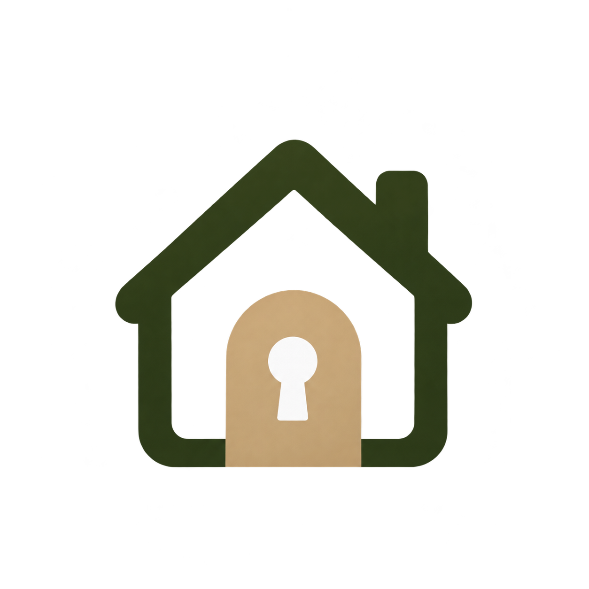

<p align="center">
  
</p>

# Rentify

**Encuentra tu próxima vivienda y gestiona tus reservas desde un solo lugar.**

Aplicación full stack para explorar viviendas de alquiler, organizar una selección en el carrito y gestionar estancias. Su interfaz responsive combina un diseño minimalista con colores verde oliva.

Desarrollada como proyecto individual de **2.º de Desarrollo de Aplicaciones Web (DAW)**.

## Tecnologías

- **Frontend:** Angular, TypeScript y SCSS.
- **Estado y comunicación:** Signals, RxJS y HttpClient.
- **Backend:** Node.js y Express con API REST.

## Funcionalidades

### Usuarios

- Registro, inicio de sesión y edición del perfil.
- Catálogo de viviendas con búsqueda, ordenación y vista de detalle.
- Carrito con contador reactivo y creación de reservas.
- Consulta, edición, cancelación y eliminación de reservas propias.

### Administradores

- Gestión completa del catálogo de viviendas.
- Gestión de las reservas de todos los usuarios y confirmación de estancias.
- Dashboard con indicadores de viviendas, reservas totales y pendientes.
- Gráfico de barras verticales por mes de inicio y donut por estado, con datos reales.

## 🚀 Ejecución local

Necesitas **Git, npm y PowerShell**, junto con Node.js compatible con Angular 22: rama 24 desde **24.15.0** o rama 22 desde **22.22.3**.

### 1. Clonar e instalar

```powershell
git clone https://github.com/255adrii/Rentify.git
cd Rentify

Push-Location server
npm.cmd ci
Pop-Location

Push-Location client
npm.cmd ci
Pop-Location
```

### 2. Arrancar las aplicaciones

Desde la raíz del proyecto, abre una terminal para el backend:

```powershell
cd server
npm.cmd start
```

En otra terminal, también desde la raíz, arranca el frontend:

```powershell
cd client
npm.cmd start
```

Abre **http://localhost:4200**, registra una cuenta e inicia sesión. Mantén el backend en el puerto **3000** y el frontend en **4200**.

### 3. Configurar el administrador

Para utilizar el panel de administración, configura estas variables **antes de arrancar el backend**, en la misma terminal PowerShell situada en `server/`:

```powershell
$env:RENTIFY_ADMIN_EMAIL = Read-Host 'Correo del administrador'
$claveAdmin = Read-Host 'Contraseña del administrador' -AsSecureString
$env:RENTIFY_ADMIN_PASSWORD = [System.Net.NetworkCredential]::new('', $claveAdmin).Password
$env:PORT = '3000'
npm.cmd start
```

Después, registra la cuenta desde la aplicación con ese mismo correo y contraseña. Al iniciar sesión aparecerá **Administración** en el menú.

La contraseña se introduce de forma oculta: mínimo ocho caracteres y máximo 72 bytes UTF-8. No hay credenciales predefinidas ni carga automática de `.env`. Las variables solo se aplican a esa terminal y no crean la cuenta por sí solas.

Si el backend ya estaba arrancado, detén el proceso antes de iniciarlo con esta configuración. **El reinicio elimina los datos en memoria.**

## Estado actual y próximos pasos

Prototipo funcional para uso local. Los datos son **temporales**: todavía no hay base de datos persistente. El carrito crea reservas, sin procesar pagos.

Próximas mejoras:

- Persistencia con PostgreSQL.
- Fotografías de viviendas.
- Búsqueda avanzada y paginación.
- Historial de reservas y notificaciones.
- Despliegue con HTTPS y configuración de producción.
